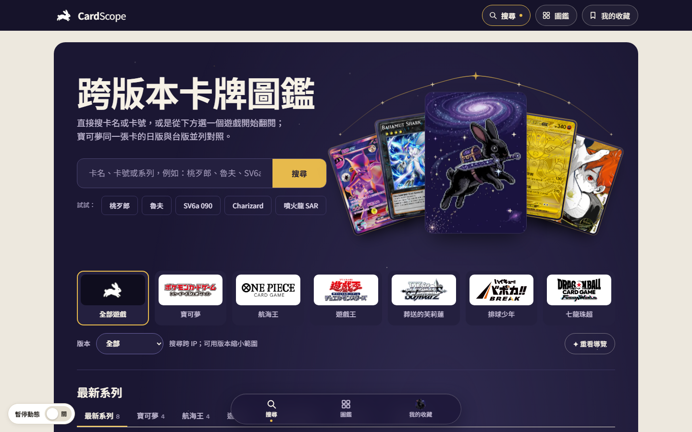

# CardScope

給繁體中文玩家的跨語言、跨版本 TCG 卡牌查證與比價網站。

**網站：** [cardscope.onrender.com](https://cardscope.onrender.com)



## 為什麼做這個

我自己買賣卡片時，同一張卡的不同語言版本、版本編號與幣別都分散在各處，比價很花時間。

所以我規劃了這個網站，並與 AI 協作完成，上線後也日常使用。

## 功能

- 收錄逾 80,000 張卡片，同一張卡的各語言、版本、幣別能同時查詢和比較。
- 掛牌、買取與成交價分開標示，不混算，也不把掛牌價當成交價。
- 沒有可靠資料時直接顯示尚未取得，不產生假價格或假交易量。

## 資料怎麼把關

- 匯入資料前先試跑並核對筆數，匯入計畫與驗證紀錄保留在 [docs/evidence](docs/evidence)。
- 資料庫變更以 migration 管理，重要取捨記錄在 [docs/adr](docs/adr)。
- 每次推送都由 GitHub Actions 跑可靠度檢查。
- 來源授權不明時採保守策略，來源政策集中在 [data/source-registry.json](data/source-registry.json)。

## 技術

JavaScript、Node.js、Supabase（PostgreSQL）、Render、GitHub Actions。

由我負責規劃、需求拆解與驗收，主要以 Claude Code 與 Codex 協作實作。

## 在本機執行

```bash
npm start
npm test
```

資料來源、API 與資料庫的說明請見 [docs/TECHNICAL.md](docs/TECHNICAL.md)。

## 作者

陳秉威，[個人網站](https://cook1e0728.github.io)
